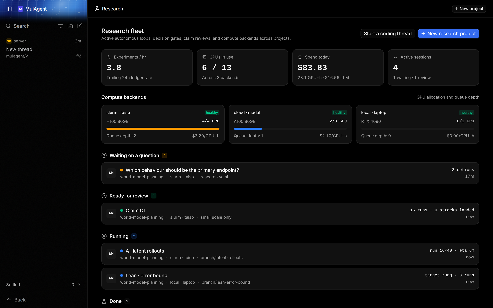
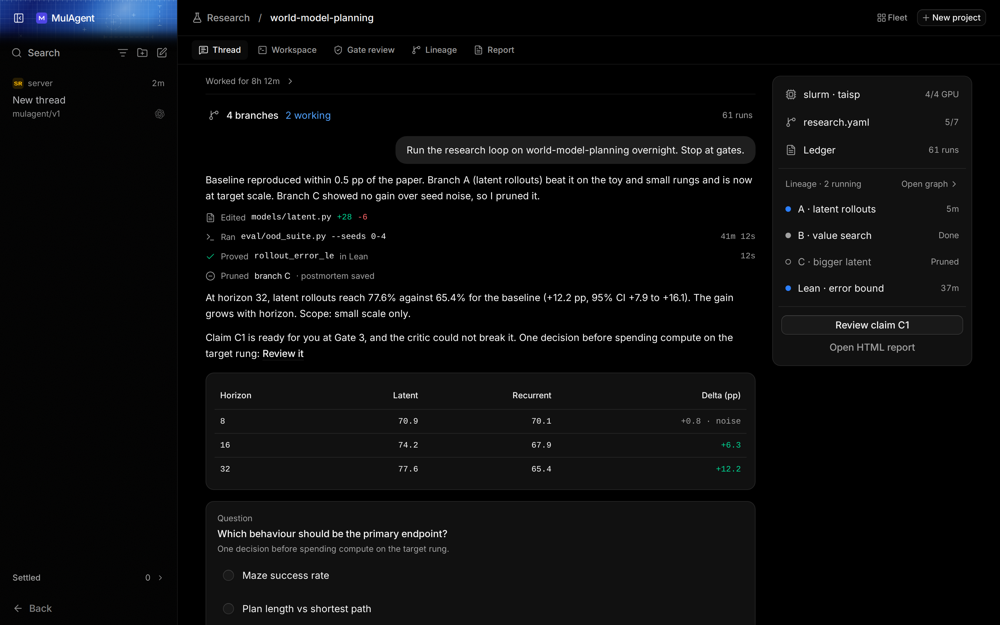
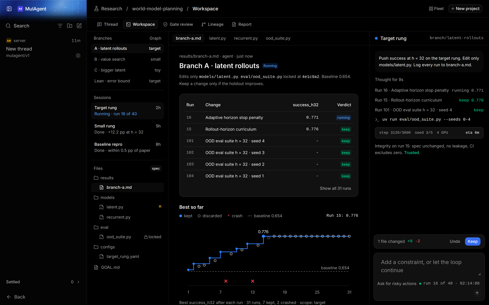
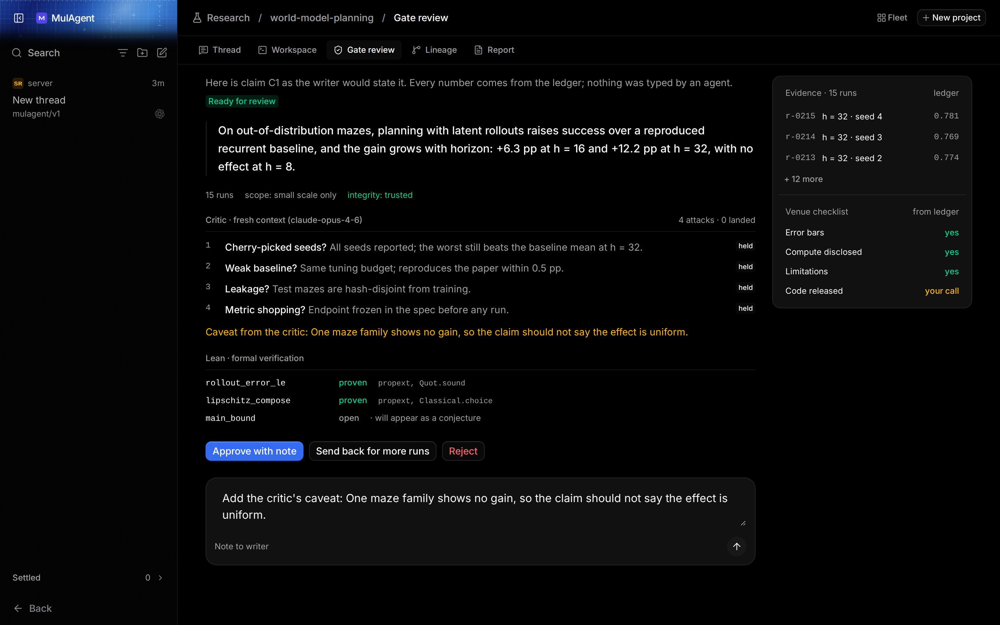
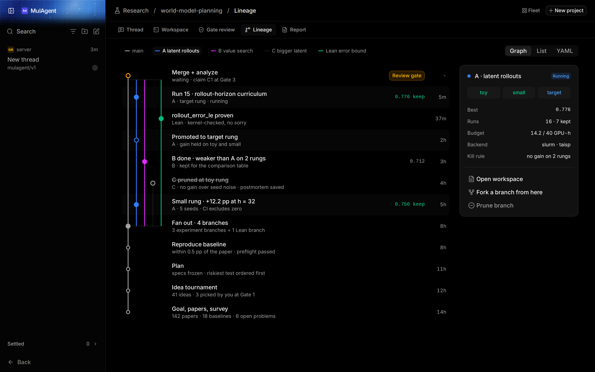
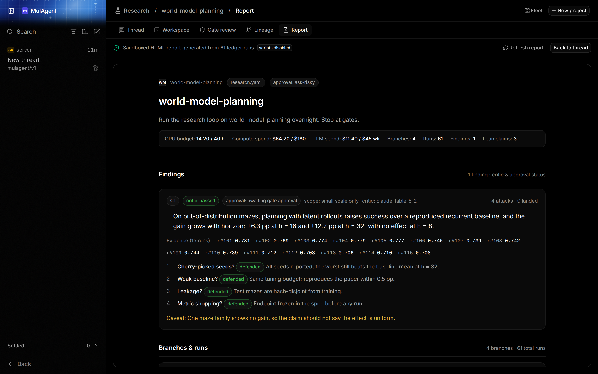

<div align="center">


# MulAgent

**Run ML research overnight. Wake up to results you can trust.**

Give MulAgent a research goal. Agents survey the literature, propose and rank ideas, run
experiments on whatever compute you have, and try to break every result before it reaches you.
You only step in at the gates that matter.

[Website](https://knn-07.github.io/mulagent/) · [Quickstart](#quickstart) · [Research setup](docs/user/research.md) · [How it works](docs/internals/research-harness.md)



</div>

## Why MulAgent

AI research agents are good at producing papers that read well. They are bad at producing numbers
you can believe. MulAgent is built around the second problem.

- **Agents never type a number.** Every figure in a finding, table or report is read from the run
  ledger and links back to the run that produced it.
- **The doer is never the judge.** A critic from a different model family, in a fresh context,
  attacks every claim against the raw logs. Claude Fable reviews GPT work; GPT reviews Claude.
- **Plans are contracts.** Specs are frozen and hashed before compute is spent. An integrity check
  flags any run that quietly changed the metric, the data split, the seeds or the locked eval.
- **Every run counts.** Discarded, crashed and pruned runs stay in the record. Claims with fewer
  than three seeds or a confidence interval that crosses zero are labelled preliminary.
- **You pick the bets.** You choose which ideas get compute, approve big budgets and sign off on
  every claim. Everything else runs on its own.

## What you get

### A research thread that stops at the right moments

Talk to the loop like any agent, watch it work through runs, and answer decision questions before
it spends compute on the next rung.



### A workspace for every branch

Each experiment branch gets its own git worktree, a results doc, a best-so-far chart and a live
agent panel. Hillclimb mode edits only the files you allow, against an eval locked at a commit.



### Claim review with the evidence attached

Before anything leaves the harness, you see the claim, the runs behind it, every critic attack,
Lean proof status and a venue checklist filled from the ledger.



### The whole tree, not just the winner

The lineage view shows every branch from literature survey to merge: what was promoted up the
toy → small → target scale ladder, what was pruned and why.



### A report where every number has a source

The provenance report is one self-contained HTML file. Findings, run tables, charts, sweeps,
Lean claims and costs are all rendered from ledger rows, each linked to its run.



## Features

|                        |                                                                                                                                                                                                                                        |
| ---------------------- | -------------------------------------------------------------------------------------------------------------------------------------------------------------------------------------------------------------------------------------- |
| **Research workflows** | Built-in DAGs for full research, paper reproduction, surveys, theorem proving and overnight hillclimbs. Branches fan out, get pruned on short budgets and join back before anything is reported.                                       |
| **Literature engine**  | Semantic Scholar, arXiv and OpenAlex search with deduplication, saturation checks and BibTeX. Citations come from the engine, never from model memory.                                                                                 |
| **Idea tournament**    | Pairwise debates with Elo ratings and clustering, so you choose from a diverse top five instead of fifty raw ideas.                                                                                                                    |
| **Any compute**        | Local processes or containers, SSH boxes, SLURM and PBS clusters with queue checking and multi-node jobs, Kubernetes, Modal and RunPod. Specs request resources, not machines, and a scheduler picks by cost, queue wait and priority. |
| **Integrity checks**   | Spec diff, leakage scan, sanity checks and bootstrap confidence intervals run on every finished run before anything reads its result.                                                                                                  |
| **Lean 4 track**       | Theoretical claims are formalized against Mathlib. A claim counts as proven only when the kernel accepts it with no `sorry` and no extra axioms.                                                                                       |
| **Python SDK**         | Install the `mulagent` package from `python/mulagent` (`pip install ./python/mulagent`) to log metrics from your training code to the ledger, with optional mirroring to Weights & Biases and MLflow.                                  |
| **Budgets and gates**  | GPU-hour, compute and LLM spend caps per project. Approval modes from "ask at every gate" to "autonomous within budget".                                                                                                               |
| **Multi-model**        | Agents run on Claude, Codex (GPT) and Gemini through one app, each on its own worktree.                                                                                                                                                |

## Quickstart

Install [Vite+](https://viteplus.dev/guide/), which also provides the pinned Node version, and open a new shell:

```sh
curl -fsSL https://vite.plus | bash
```

Clone and run:

```sh
git clone https://github.com/KNN-07/mulagent.git
cd mulagent
vp i
vp run dev
```

Open the pairing URL the dev runner prints. MulAgent opens on the research fleet.

Then follow the [research setup guide](docs/user/research.md) to add a compute backend
(`research-backends.yaml`), log metrics from your experiments with the Python SDK and review
your first run.

In your training script:

```python
import mulagent

mulagent.init()
for step, batch in enumerate(loader):
    loss = train_step(batch)
    mulagent.log_metric("loss", loss, step=step, split="train")
mulagent.log_metric("success_h32", evaluate(), split="holdout")
mulagent.finish()
```

## Status

MulAgent is new. The research loop, ledger, integrity checks, report and local backend are tested
end to end. SSH, SLURM, PBS, Kubernetes and the cloud backends are tested against recorded
command output and still need qualification on real clusters. Issues and reports from real
runs are very welcome.

## Built on

MulAgent is a fork of [T3 Code](https://github.com/pingdotgg/t3code). Coding threads, providers, worktrees and remote
access come from T3 Code.

## License

[MIT](LICENSE). See [NOTICE](NOTICE) for upstream credits.
